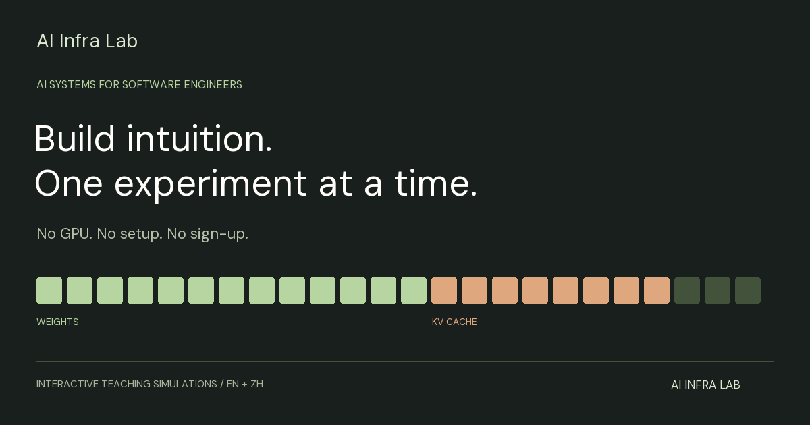

# InferenceLearning · AI Infra Lab

Interactive AI infrastructure experiments for software engineers. Start with a live KV-cache memory budget, then explore twelve bilingual lessons on memory, computation, scheduling, and capacity planning.



No GPU, account, API key, runtime dependencies, or backend. All numerical results are **teaching simulations**, not measured benchmarks.

## Run locally

Use Node.js 18+ to prepare the static site; no dependency installation is needed.

```sh
npm run build
python3 -m http.server 4173 --directory dist
```

Open `http://localhost:4173`. English is the default; use the 中文 / EN toggle or `?lang=zh`. Previously saved language preferences still apply. Opening the root `index.html` also works for local exploration; build and serve `dist` to test the dedicated social entry pages.

## Experiments

| Start here | What you can change | What you can observe |
| --- | --- | --- |
| KV cache | Context, concurrency, capacity | Weights + KV + runtime reserve |
| Continuous batching | Scheduler, long request length | Slot utilization and completion steps |
| Speculative decoding | Acceptance rate, draft length/cost | Expected tokens and modeled speedup |

The full route includes prefill/decode, roofline, KV cache, GQA, paging, FlashAttention, quantization, batching, speculation, TP/PP/DP, training workloads, and a capacity challenge. Each lesson has formulas, assumptions, a quiz, and local notes. The capacity challenge requires both a correct answer and a configuration that meets the original load and memory target.

## Share and privacy

- Copy a link to the current experiment, parameters, and language. Unknown or invalid parameters fall back to validated defaults.
- Download a 1200 × 675 PNG with parameters, results, insight, project branding, and a simulation label.
- Three dedicated HTML entry pages have distinct titles and social cards, readable by crawlers without JavaScript.
- Notes and progress stay in browser local storage and are never included in share URLs. Export notes as Markdown to keep a backup. Moving to another origin does not transfer old notes.
- The app adds no analytics, cookies, registration, or cloud sync. The static host may retain ordinary request logs. Fonts are served from this repository under SIL OFL 1.1, with license files included.

## Deploy to GitHub Pages

The public repository is [pendaralearning/InferenceLearning](https://github.com/pendaralearning/InferenceLearning). The site is live at [AI Infra Lab](https://pendaralearning.github.io/InferenceLearning/). Subsequent pushes to `main` deploy automatically through this workflow:

1. In repository Settings → Pages, select **GitHub Actions** as the source.
2. Run **Deploy AI Infra Lab to GitHub Pages**, or push to `main` after enabling Pages.
3. The workflow verifies the code, builds `dist`, and deploys only public runtime assets.
4. The build takes the real canonical URL from `actions/configure-pages` and the repository URL from `GITHUB_REPOSITORY`. This also enables the source and correction links. No hostname is guessed.
5. Verify the deployment URL reported by Actions before using the launch copy.

A custom domain can be configured later in GitHub Pages and DNS. See [GitHub Pages workflow documentation](https://docs.github.com/en/pages/getting-started-with-github-pages/using-custom-workflows-with-github-pages).

For another static host, set `siteUrl` and `repositoryUrl` in `site.config.json`, or build with `SITE_URL=https://your-host/path`. `siteUrl` is the site base, without `index.html`. Never put tokens or secrets in this configuration.

Without a configured public URL, canonical/social image URLs are omitted and shares use the current preview origin. A local preview link is not publicly accessible. The build must be run before publishing; do not deploy the whole source tree.

## Validate

```sh
npm run check
npm test
npm run audit:public
npm run build
```

Tests cover all lesson translations, alternative calculation branches, language/state preservation, parameter URL round trips, invalid input handling, safe note rendering, and the capstone completion condition. See `launch/QA.md` for browser checks.

## Source layout

- `app.js`: lesson UI, navigation, calculators, quizzes, and notes.
- `launch.js`: interactive landing page, share validation, result cards, project information, and corrections.
- `curriculum.js`, `translations.js`, `i18n.js`: stable lesson IDs and bilingual content.
- `site.config.json`, `config.js`: optional public destinations; the build emits resolved runtime configuration.
- `scripts/build.cjs`: dependency-free static build and social metadata.
- `assets/`: four original PNG social cards. `scripts/social-assets.py` regenerates them with Pillow and a local font; the deployed build needs neither.
- `.github/workflows/pages.yml`: Pages build and deployment.
- `launch/`: X drafts and launch notes. These are not deployed.

## Sources and limitations

The Reading page links public papers on PagedAttention, FlashAttention, GQA, speculative decoding, transformer inference scaling, AWQ, DPO, PPO, and GRPO. It includes unit explanations and limitations. Only public reference material is linked.

The visual design, learning route, and experiment implementations are independently authored. This educational project does not claim production-serving or kernel benchmark results.

## 中文

面向软件工程师的中英双语 AI 基础设施交互学习平台。首页可直接调整 KV cache 参数；12 节实验包含公式、假设、知识检验和本地笔记。支持参数链接、结果卡片、公开论文阅读和纠错信息生成。

运行 `npm run build` 后用静态服务器打开 `dist`。正式网站：[https://pendaralearning.github.io/InferenceLearning/](https://pendaralearning.github.io/InferenceLearning/)。后续推送到 main 会自动检查并部署。本项目没有自动发布 X 内容。

Review records: [content and formulas](docs/CONTENT_REVIEW.md), [asset provenance and font licenses](assets/THIRD_PARTY_NOTICES.txt), and [release privacy checks](docs/PRIVACY_REVIEW.md).
